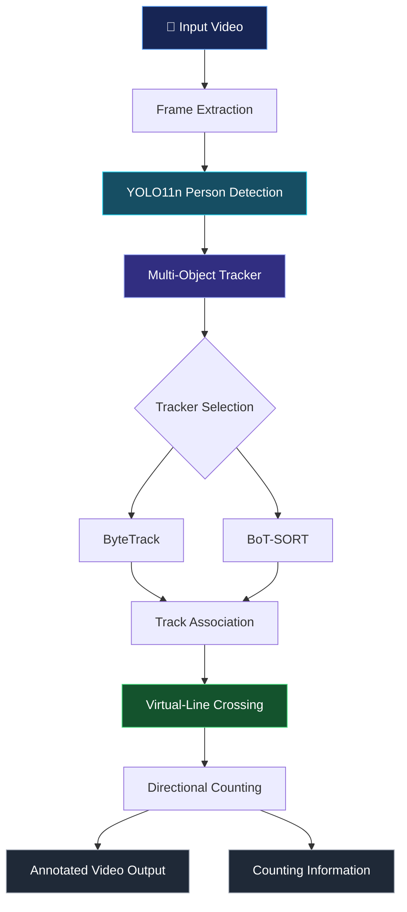

<div align="center">

# 🏢 Occupancy Estimation & Tracking System

### Turning Video Streams into Actionable Occupancy Insights

**A Computer Vision Project for People Detection, Multi-Object Tracking, and Virtual-Line Crossing Analysis**

<br>


<br>

**Detect. Track. Count. Analyze.**

*A video-based approach to understanding pedestrian movement and occupancy-related activity.*

<br>

</div>

---

## 📌 Table of Contents

- [Overview](#-overview)
- [Project Objectives](#-project-objectives)
- [Key Features](#-key-features)
- [System Architecture](#-system-architecture)
- [How It Works](#-how-it-works)
- [Technology Stack](#-technology-stack)
- [Project Structure](#-project-structure)
- [Experimental Methodology](#-experimental-methodology)
- [Results and Observations](#-results-and-observations)
- [Installation](#-installation)
- [Usage](#-usage)
- [Technical Challenges](#-technical-challenges)
- [Applications](#-potential-applications)
- [Limitations](#-limitations)
- [Future Improvements](#-future-improvements)
- [Contributing](#-contributing)
- [Author](#-author)

---

## 🔍 Overview

The **Occupancy Estimation & Tracking System** is a computer vision project designed to detect people in video streams, track their movement across consecutive frames, and analyze their crossings of a virtual counting line.

The system uses a pretrained **YOLO11n object detection model** alongside multi-object tracking algorithms to associate detected people across frames. A virtual-line crossing mechanism is then used to identify movement events and derive counting information.

The project explores how object detection, tracking, and geometric event detection can be combined to develop a practical foundation for occupancy monitoring.

Rather than training a custom detection model, this implementation focuses on integrating existing computer vision components and evaluating their behavior under different video conditions.

### 🎯 The Core Idea

Transform ordinary video into structured movement information.

```text
Video Input → Person Detection → Object Tracking
                                     ↓
                            Virtual-Line Crossing
                                     ↓
                              Counting Events
                                     ↓
                         Occupancy-Related Insights
```

The project also explores practical challenges such as occlusion, camera movement, tracking instability, and virtual-line placement.

---

## 🎯 Project Objectives

- Implement person detection using a pretrained YOLO11n model.
- Track detected people across consecutive video frames.
- Explore ByteTrack and BoT-SORT for multi-object tracking.
- Detect crossings of a configurable virtual line.
- Analyze directional movement where supported by the implementation.
- Evaluate system behavior across different video scenarios.
- Identify practical limitations affecting reliable people counting.
- Establish a baseline for future occupancy estimation improvements.

---

## ✨ Key Features

| Feature | Description |
|---|---|
| 👁️ Person Detection | Detect people in video frames using YOLO11n. |
| 🆔 Multi-Object Tracking | Associate detections across frames using tracking algorithms. |
| 🔄 Tracker Comparison | Experiment with ByteTrack and BoT-SORT. |
| 📏 Virtual-Line Detection | Identify crossings of a defined line in the video. |
| 🔢 People Counting | Derive counts from detected crossing events. |
| 🎞️ Video Processing | Process video files and generate annotated outputs. |
| 🧪 Experimental Testing | Investigate behavior under different scene conditions. |
| 📊 Result Visualization | Inspect detection, tracking, and counting behavior through processed videos. |

---

## 🏗️ System Architecture

The following diagram illustrates the conceptual processing pipeline.



> **Note:** This is a conceptual architecture. The exact execution sequence, tracker configuration, and output format depend on the repository's implementation.

---

## ⚙️ How It Works

### 1. Video Input

The system receives a video file containing pedestrian movement.

Frames are processed sequentially to analyze people appearing in the scene.

### 2. Person Detection Using YOLO11n

The pretrained YOLO11n model detects people in individual frames and generates bounding boxes around detected objects.

Each detection provides information used by the subsequent tracking stage.

Using a pretrained model avoids the need to train a custom object detector for the initial implementation.

### 3. Multi-Object Tracking

Object detection identifies people in individual frames, but detection alone does not establish which person corresponds to a detection in the next frame.

A tracking algorithm associates detections over time and assigns track identities.

This helps maintain consistent identities and supports the detection of movement across the scene.

### 4. ByteTrack and BoT-SORT

The project explores two multi-object tracking approaches.

**ByteTrack**

ByteTrack associates detections across frames using both high-confidence and lower-confidence detections, helping recover tracks that might otherwise be lost.

**BoT-SORT**

BoT-SORT combines detection association with motion-based tracking and can incorporate camera-motion compensation and appearance information, depending on the configuration.

Their performance depends on factors such as detection quality, scene conditions, tracker parameters, and camera movement.

### 5. Virtual-Line Crossing

A virtual line is defined within the video frame.

The system uses tracked-object positions and crossing logic to identify when a tracked person moves across the line.

Depending on the implementation, these events can be categorized by direction.

```text
             VIDEO FRAME

    ┌─────────────────────────┐
    │                         │
    │       Person A          │
    │          ↓              │
    │  ─ ─ ─ ─ ─ ─ ─ ─ ─ ─  │  ← Virtual Line
    │          ↓              │
    │       Person A          │
    │                         │
    └─────────────────────────┘

         Crossing Event
               ↓
          Update Count
```

The line's position and orientation influence counting behavior. Incorrect placement may lead to missed crossings or unintended detections.

### 6. Counting and Output Generation

When a valid crossing is detected, the corresponding counting event is processed.

The system can generate annotated video outputs for visual inspection of detections, tracks, and crossing behavior.

**Important distinction:** Counting line-crossing events is not automatically equivalent to measuring current occupancy. A reliable occupancy estimate also requires an initial occupancy value and correct accounting of entries and exits.

---

## 🛠️ Technology Stack

| Technology | Purpose |
|---|---|
| Python | Primary programming language |
| YOLO11n | Person detection |
| Ultralytics | YOLO model integration |
| OpenCV | Video and image processing |
| Supervision | Tracking and line-crossing utilities, where used |
| ByteTrack | Multi-object tracking |
| BoT-SORT | Alternative multi-object tracking |
| NumPy | Numerical operations, where required |

The actual dependencies and versions should be taken from the repository's requirements files and configuration.

---

## 📁 Project Structure

A simplified view of the expected project organization:

```text
occupancy-estimation-baseline/
│
├── 📂 assets/
│   ├── 📂 screenshots/
│   ├── 📂 animations/
│   └── 📂 architecture/
│
├── 📂 configs/
│   └── tracker configurations
│
├── 📂 videos/
│   └── input video files
│
├── 📂 outputs/
│   └── annotated video results
│
├── 📂 scripts/
│   └── processing scripts
│
├── 📄 requirements.txt
├── 📄 README.md
└── 📄 .gitignore
```

*This is an illustrative structure. Refer to the actual repository for the current directory names and file organization.*

---

## 🧪 Experimental Methodology

The project uses video-based experiments to investigate the behavior of people detection, tracking, and virtual-line crossing.

The experimental approach focuses on identifying conditions that influence counting reliability.

### Experimental Scenarios

| Scenario | Objective |
|---|---|
| Baseline Testing | Examine detection, tracking, and line-crossing behavior under ordinary conditions. |
| Different Crowd Densities | Investigate tracking behavior as the number of visible people changes. |
| Bidirectional Movement | Examine counting behavior when people move in different directions. |
| Occlusion | Investigate how partially hidden people affect tracking continuity. |
| Camera Movement | Observe how camera shake affects detection, tracking, and line placement. |
| Line Placement | Examine how the position of the virtual line influences crossing detection. |

These categories describe the intended evaluation dimensions; individual outcomes should be documented using the corresponding experimental videos.

### Evaluation Approach

The initial evaluation emphasizes qualitative inspection of annotated video outputs.

Important observations include:

- Consistency of tracking identities.
- Correctness of detected line-crossing events.
- Stability of tracking during occlusion.
- Sensitivity to camera movement.
- Influence of virtual-line positioning.
- Differences between tracking configurations.

For a more rigorous evaluation, the system could be tested against manually annotated ground truth using counting MAE, counting RMSE, ID switches, IDF1, or HOTA, where suitable reference annotations are available.

No numerical performance claims are made without measured results.

---

## 📊 Results and Observations

The system provides a baseline for analyzing pedestrian detection and tracking through video.

The most important evaluation areas are:

**Detection Quality**

The quality of person detection influences the tracking stage. Missed detections or inaccurate bounding boxes can affect subsequent tracking and counting.

**Tracking Stability**

Trackers must maintain consistent identities across frames. Occlusion, overlapping pedestrians, and camera movement can introduce identity switches or fragmented tracks.

**Counting Reliability**

Virtual-line crossing detection depends on correct track association, appropriate line placement, and reliable crossing logic.

**Environmental Sensitivity**

Changes in lighting, video quality, camera position, and pedestrian density may affect system behavior.

### Demonstration Gallery

Add screenshots from your actual processed videos below.

| Person Detection | Multi-Object Tracking |
|---|---|
| `` | `` |

| Virtual-Line Crossing | Processed Output |
|---|---|
| `` | `` |

*Replace these example paths with actual images in the repository. Remove any entry for which no corresponding asset exists.*

---

## 🚀 Installation

### Prerequisites

- Python version compatible with the project's dependencies.
- Git.
- A compatible environment for running the required computer vision libraries.
- Input video files for processing.

A compatible NVIDIA GPU can accelerate inference, but actual hardware requirements depend on the selected dependencies and execution configuration.

### Step 1: Clone the Repository

```bash
git clone https://github.com/Ashwin095-exp/occupancy-estimation-baseline.git
```

### Step 2: Enter the Project Directory

```bash
cd occupancy-estimation-baseline
```

### Step 3: Create a Virtual Environment

```bash
python -m venv .venv
```

Activate it on Windows:

```powershell
.venv\Scripts\Activate.ps1
```

On Linux or macOS:

```bash
source .venv/bin/activate
```

### Step 4: Install Dependencies

If the repository contains a `requirements.txt` file:

```bash
pip install -r requirements.txt
```

Otherwise, install the dependencies specified by the project configuration.

---

## ▶️ Usage

The precise execution command depends on the script and arguments provided by the repository.

A typical workflow involves:

1. Selecting an input video.
2. Loading the YOLO11n model.
3. Configuring the desired tracker.
4. Defining the virtual counting line.
5. Running the video-processing pipeline.
6. Inspecting the annotated output.

Example command format:

```bash
python <actual_script_name>.py --source <input_video_path>
```

**The command above is a placeholder, not a verified executable command.** Replace it with the actual script name and supported arguments.

For reproducible experiments, maintain consistent input videos and configuration settings when comparing tracking approaches.

---

## ⚠️ Technical Challenges

Developing a reliable people-counting system involves more than detecting objects in individual frames.

### Tracking Instability

Temporary detection failures can interrupt track continuity and affect counting.

### Occlusion

People walking close together may overlap, making it difficult to preserve individual identities.

### Camera Movement

Camera shake can change the apparent position of objects and complicate virtual-line placement.

### Bounding-Box Accuracy

Bounding boxes that are too wide, poorly positioned, or unstable may influence the point used to determine whether a person crossed the counting line.

### Virtual-Line Configuration

A poorly positioned line may count irrelevant movement or fail to capture the intended pedestrian flow.

These challenges make tracking configuration, line placement, and experimental validation important parts of the system.

---

## 🌍 Potential Applications

The techniques explored in this project may support applications such as:

- 📚 **Library Occupancy Monitoring** — Understanding pedestrian flow through library entrances.
- 🏫 **Classroom Utilization** — Analyzing entry and exit events.
- 🏢 **Building Access Analysis** — Estimating pedestrian movement through monitored entrances.
- 🚶 **Pedestrian Flow Analysis** — Studying directional movement in selected areas.
- 🛍️ **Retail Analytics** — Analyzing customer movement through defined counting zones.

These are potential applications, not claims of validated deployment.

Real-world use would require appropriate camera placement, testing, privacy safeguards, and validation against ground-truth counts.

---

## 🔭 Future Improvements

Potential extensions include:

- Improving track continuity under occlusion.
- Comparing ByteTrack and BoT-SORT using quantitative metrics.
- Adding configurable virtual-line positions.
- Improving directional counting logic.
- Implementing occupancy state estimation using initial occupancy and entry/exit events.
- Evaluating performance across different crowd densities.
- Adding automated experiment summaries.
- Developing a dashboard for displaying counting results.
- Optimizing video-processing speed.
- Adding privacy-conscious data handling.

These improvements provide a path toward a more robust and measurable occupancy estimation system.

---

## 📚 Research and Technical Notes

This project explores the integration of established computer vision techniques into a video-based people-counting pipeline.

Its central technical components are:

1. **Object Detection:** Locating people within individual frames.
2. **Multi-Object Tracking:** Associating detections across consecutive frames.
3. **Geometric Event Detection:** Identifying crossings of a virtual line.
4. **Counting Logic:** Converting crossing events into directional counts.
5. **Experimental Evaluation:** Investigating factors that affect counting reliability.

The project illustrates how errors at one stage of a computer vision pipeline can propagate into subsequent stages.

For example, a missed detection can interrupt a track, while an unstable track can cause an incorrect crossing event.

Understanding these dependencies is essential when designing reliable video analytics systems.

---

## 🤝 Contributing

Contributions, suggestions, and technical discussions are welcome.

Potential areas for contribution include:

- Tracking algorithm comparisons.
- Improved counting logic.
- Experimental evaluation.
- Performance optimization.
- Documentation improvements.
- Visualization and reporting.

To contribute:

1. Fork the repository.
2. Create a feature branch.
3. Implement and test your changes.
4. Submit a pull request describing the improvement.

Please include reproducible examples when reporting bugs or proposing changes.

---

## 👨‍💻 Author

**Ashwin Singh**

Electronics and Telecommunication Engineering Student  
Interested in Computer Vision, Artificial Intelligence, and Applied Engineering.

GitHub: [@Ashwin095-exp](https://github.com/Ashwin095-exp)

**Project Repository:** [Occupancy Estimation & Tracking](https://github.com/Ashwin095-exp/occupancy-estimation-baseline)

---

<div align="center">

### 👁️ Detect People. Track Movement. Understand Occupancy.

*Building a practical foundation for video-based occupancy analysis.*

</div>
